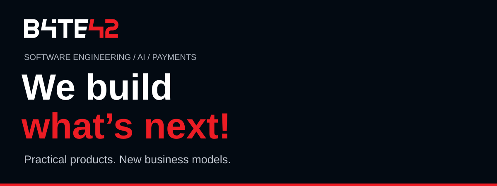
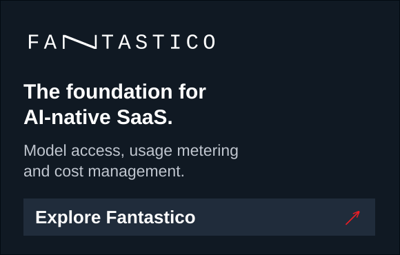
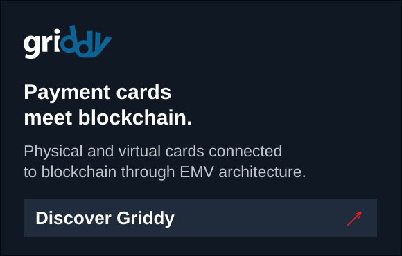

<!-- Byte42 organization profile: design preview -->

  
  
  

We combine software engineering, artificial intelligence and payment expertise to turn emerging technologies into practical products and new business models.

## AI, built into the business.

<table>
<tr>
<td width="50%"></td>
<td width="50%"></td>
</tr>
</table>

## Next-generation payments.

<table>
<tr>
<td width="50%"></td>
<td width="50%"></td>
</tr>
</table>

